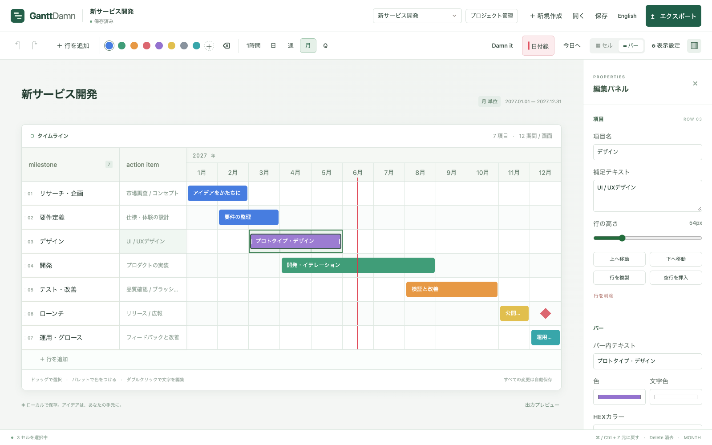
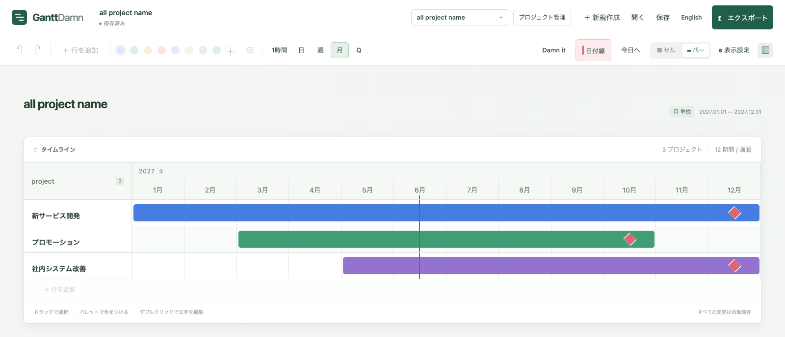

# GanttDamn

[日本語](README.md) | English

GanttDamn is a local web app for creating Gantt charts and roadmaps by coloring cells, much like a spreadsheet. Plan individual projects, compare schedules across projects, and export charts for presentations and meetings.

No backend or account is required. Projects are stored in your browser.

## Screenshots

These screenshots use demonstration data and show the Japanese interface. Use the **English** button in the app to switch languages.

### Individual project

Colored bars show scheduled work, and diamonds mark milestones. Select a bar to edit item names, notes, labels, and colors in the properties panel.



### all project name

Compare all projects with one row and one summary bar per project. See overall time spans, overlapping schedules, and milestones at a glance.



## Features

- **Grid editing:** select and fill ranges, resize bars, edit text directly, reorder rows, and undo or redo changes.
- **Five timeline scales:** Hour, Day, Week, Month, and Quarter (Q), with a working calendar for each project.
- **Project management:** create, switch, rename, duplicate, or delete projects, plus two views of all projects.
- **Damn it mode:** drag a bar to move it and all bars starting at the same time or later.
- **Date line and navigation:** show the current position and jump to it, accounting for non-working hours.
- **Preview and export:** PNG, SVG, XLSX, and JSON, with margins and a 16:9 layout option.
- **Japanese / English:** switch the UI and date labels while preserving user-entered project names and text.

## Quick start

You need Node.js 22.12 or later, npm, and a desktop browser. Clone this repository or download its ZIP, then run these commands inside the app folder:

```sh
npm ci --ignore-scripts --legacy-peer-deps
npm start
```

Your default browser opens [http://127.0.0.1:4317](http://127.0.0.1:4317). Open that address manually if needed. Press `Ctrl+C` in the terminal to stop the app. The server listens only on localhost.

After installing dependencies, you can also launch `GanttDamn.app` on macOS or run `bash GanttDamn.sh` on Ubuntu. Keep the launchers inside the app folder. See [launcher instructions](docs/user-guide.en.md#launchers).

## Basic usage

1. Choose **New project** and set a name, timeline scale, and start date. A sample chart opens on the first launch.
2. Add rows and double-click names or notes in the left columns to edit them.
3. Drag across timeline cells to select a range, then choose a palette color to create a bar.
4. Select a bar to edit its label or color, or drag its edges to resize it. You can also add a diamond milestone from an empty cell.
5. Choose **Export**, review the range, and save in your preferred format.

To shift schedules together, enable **Damn it** and drag the body of a bar. In an individual project, the change applies within that project; in an overview, it can affect all projects. See the [user guide](docs/user-guide.en.md) for detailed controls, shortcuts, and timeline behavior.

## Project views

| View | Contents | Use it for |
|---|---|---|
| Individual project | One project's item names, notes, bars, and diamonds | Editing items and building schedules |
| `all` | Every project's items on a shared timeline | Reviewing details and shifting schedules across projects |
| `all project name` | One row, one summary bar, and diamonds per project | Comparing overall project time spans and overlaps |

A summary bar spans the earliest scheduled start through the latest scheduled end. The summary view preserves the original items and individual bars. Switch to an individual project to add items, edit names, or resize bars.

## Storage and export

Changes are saved automatically in IndexedDB for the same browser, profile, and origin. Clearing browser data removes those projects, so use JSON backups for long-term storage or transfer to another device.

| Format | Purpose |
|---|---|
| PNG | Images for meeting materials and presentations |
| SVG | Vector images for resizing |
| XLSX | Editable Excel cells with chart colors and text |
| JSON | Exporting and restoring chart data within the visible range |

Regular previews and exports include all rows and the number of **Visible periods**, starting at the current horizontal scroll position. Bars crossing the range boundaries are clipped to that range.

**Use Back up all data to save the full project range.** In an individual project, this saves the complete project. In `all` or `all project name`, it saves the original data for every project. Importing JSON assigns new IDs and does not overwrite existing projects.

## Data transmission and external connections

On 2026-11-22, source review and Google Chrome checks of the development and built versions found **zero attempts by the app to send requests to external servers within the tested workflows.** The checks included project editing, saving, overview modes, PNG/SVG/XLSX/JSON export, and restoring a backup.

- Project data is stored in the browser's IndexedDB, and the language preference in localStorage. No project-upload API, analytics, or telemetry implementation was found in the application code.
- JSON imports are read from local files in the browser. Previews and export files are also generated in the browser. No external CDN or web-font requests were observed.
- Normal startup loads the app from `127.0.0.1:4317`. The launcher's startup probe also stays local. During development, Vite opens a WebSocket connection to the same local server for update notifications.

Dependency installation commands such as `npm ci` contact external package sources. Traffic generated by the operating system, browser software, or extensions is outside this review. See the [network verification record](docs/network-verification.md) for tested workflows, request counts, and reproduction steps.

## Environments and limitations

| Environment | Verification status |
|---|---|
| macOS / Google Chrome | UI interactions, storage, and export checked during development |
| Ubuntu | Startup scripts and a desktop launcher provided; desktop GUI not verified on an Ubuntu machine |
| Windows / Safari | Not verified |
| Desktop Excel / PowerPoint | Rendering of exported files not verified in these applications |

The app is intended for desktop use. It does not provide effort or resource management, task dependencies, automatic holiday handling, collaboration, cloud synchronization, or direct PPTX export.

## Development

Built with React, TypeScript, Vite, Tailwind CSS, Zustand, date-fns, and ExcelJS. Date and editing logic lives in `src/domain/`, UI components in `src/components/`, persistence in `src/storage/`, and export code in `src/export/`.

```sh
npm run dev           # Development server: 127.0.0.1:4317
npm test              # Unit tests for dates, editing, storage, and export
npm run test:e2e      # Browser interaction tests using Chrome
npm run test:launcher # Platform-specific launcher tests
npm run build         # Type checking and production build
npm run preview       # Preview the build: 127.0.0.1:4318
```

Browser tests require Google Chrome. To run them alongside the development server, use a different port: `GANTT_TEST_PORT=4327 npm run test:e2e`. If you already have a Playwright-managed Chromium installation, you can also set `PLAYWRIGHT_CHANNEL=chromium`. These environment-variable command examples use shell syntax for macOS and Linux.

Local project folders (`projects/`, `project-data/`, `backups/`, and `exports/`), dependencies, build output, and test results are excluded from Git. README screenshots are kept in `assets/screenshots/`.

## Reporting bugs

Open an issue in this repository with your OS, browser, steps to reproduce, expected result, and actual result. Include demonstration data or screenshots when useful.

## License

### This application

**GanttDamn is currently provided free of charge, and its original code is licensed under MIT.** Commercial use, modification, and redistribution are permitted subject to retaining the copyright and license notices. See [LICENSE](LICENSE) for the full terms.

### Third-party libraries

As of 2026-11-22, the review covered direct and transitive dependencies and libraries embedded in ExcelJS's browser bundle. No mandatory paid-license purchase was identified in the declarations and texts reviewed. Third-party code retains its respective upstream licenses.

| Component | License identified |
|---|---|
| React / React DOM / Zustand / date-fns / ExcelJS | MIT |
| Vite / Tailwind CSS / Vitest, related plugins, and type definitions | MIT |
| TypeScript / Playwright / fake-indexeddb | Apache-2.0 |
| Transitive and bundled libraries | MIT, ISC, BSD-3-Clause, BlueOak-1.0.0, MPL-2.0, CC-BY-4.0, Zlib, and others; JSZip uses its MIT option |

Main library license texts: [React](https://github.com/facebook/react/blob/v19.2.0/LICENSE), [Zustand](https://github.com/pmndrs/zustand/blob/v5.0.8/LICENSE), [date-fns](https://github.com/date-fns/date-fns/blob/v4.1.0/LICENSE.md), [ExcelJS](https://github.com/exceljs/exceljs/blob/v4.4.0/LICENSE), and [TypeScript](https://github.com/microsoft/TypeScript/blob/v5.9.3/LICENSE.txt).

The missing npm declaration for `buffers@0.1.1` was resolved using the official Debian MIT license record and a byte-for-byte match of all five bundled source files. The [verification record](licenses/buffers-provenance.md) and license notice are included, and source hashes are checked before builds. Dependency versions remain unchanged to preserve ExcelJS compatibility.

Copyright notices, license texts, and NOTICE materials are collected in [THIRD_PARTY_NOTICES.txt](THIRD_PARTY_NOTICES.txt). See [licenses/](licenses/README.md) for supplemental sources and the [license record](docs/dependency-licenses.md) for the full inventory and remediation. Builds also include `LICENSE.txt` and `THIRD_PARTY_NOTICES.txt`.

```sh
npm run licenses:generate # Regenerate notices and inventory after dependency changes
npm run licenses:check    # Verify notices, declarations, and the browser-vendor snapshot
```

The build checks these materials too. If you change the third-party code being distributed, recheck applicable notice, modification, and source-availability obligations in the original licenses.
