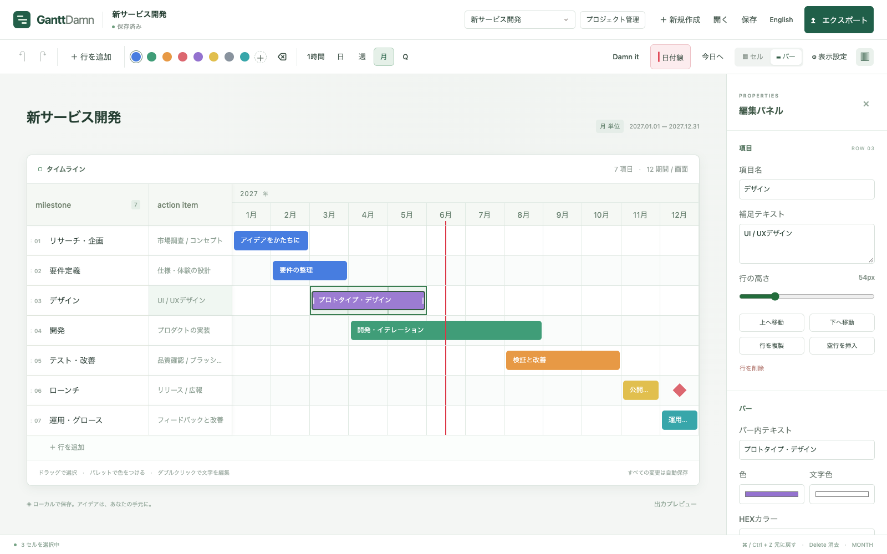
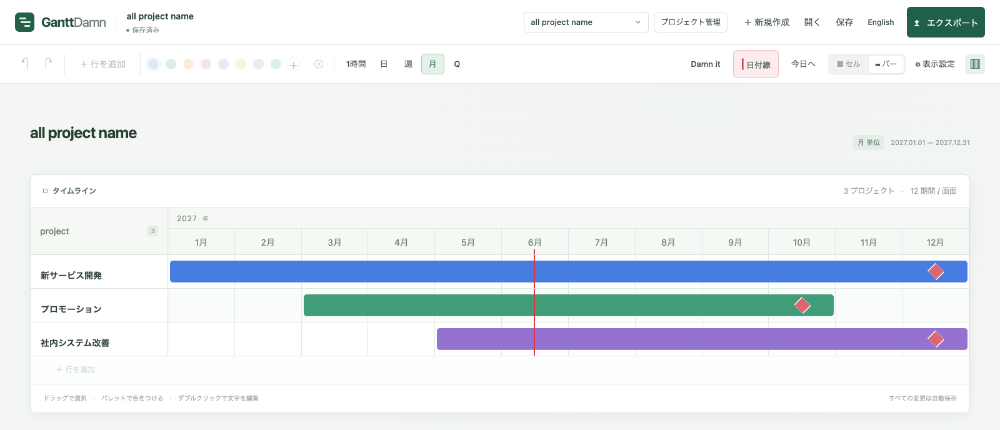

# GanttDamn

日本語 | [English](README.en.md)

Excelのセルを塗る感覚で、ガントチャートやロードマップを作成できるローカルWebアプリです。個別プロジェクトの計画から、複数プロジェクトのスケジュール比較、会議資料向けの画像出力まで対応します。

バックエンドやアカウント登録は不要です。プロジェクトはブラウザ内に保存します。

## スクリーンショット

以下は説明用のサンプルデータです。

### 個別プロジェクト

項目別のスケジュールを色付きバーで表現し、ダイヤモンドで節目を示します。バーを選択すると、右側の編集パネルで項目名・補足・ラベル・色などを変更できます。



### all project name

全プロジェクトを1行ずつ並べ、各PJのスケジュールを1本のバーに集約します。PJ全体の期間や重なり、節目を比較できます。



## 主な機能

- **グリッド編集**：範囲選択・塗りつぶし、バーの伸縮、項目の直接編集、行の並べ替え、Undo/Redo。
- **5種類の時間軸**：1時間・日・週・月・四半期（Q）。PJごとの稼働日・営業時間を設定可能。
- **プロジェクト管理**：作成・切替・名前変更・複製・削除と、2種類の全PJ一覧。
- **Damn itモード**：ドラッグしたバーと開始日時が同じか後ろにあるバーをまとめて移動。
- **日付線とジャンプ**：現在位置の表示と、営業時間外を考慮した「今日へ」の移動。
- **プレビューと出力**：PNG・SVG・XLSX・JSON、余白調整、16:9配置。
- **日本語 / English**：UIと日付ラベルを切替。入力済みのPJ名や項目名はそのまま保持。

## クイックスタート

Node.js 22.12以降、npm、デスクトップブラウザが必要です。このリポジトリをクローン、またはZIPで取得し、アプリのフォルダ内で実行します。

```sh
npm ci --ignore-scripts --legacy-peer-deps
npm start
```

既定のブラウザで [http://127.0.0.1:4317](http://127.0.0.1:4317) が開きます。開かなければ手動でアクセスしてください。終了はターミナルで `Ctrl+C` を押します。サーバーはローカルホストだけで待ち受けます。

依存パッケージのインストール後は、macOSでは `GanttDamn.app`、Ubuntuでは `bash GanttDamn.sh` でも起動できます。ランチャーはアプリのフォルダ内に置いたまま使います。[ランチャーの詳細](docs/user-guide.md#ランチャー)。

## 基本的な使い方

1. 「新規作成」でPJ名・時間軸・開始日を設定します。初回起動ではサンプルチャートが開きます。
2. 行を追加し、左側の項目名・補足をダブルクリックして入力します。
3. 時間軸のセルをドラッグして範囲を選び、パレットの色を押してバーを作成します。
4. バーを選択してラベルや色を編集し、両端をドラッグして期間を伸縮します。空のセルからダイヤモンドも追加できます。
5. 「エクスポート」で表示範囲を確認し、必要な形式で保存します。

一括日程変更には「Damn it」をオンにしてバー本体をドラッグします。個別PJではそのPJ内、全PJ一覧では全PJが対象です。詳しい操作・ショートカット・時間軸の仕様は[ユーザーガイド](docs/user-guide.md)を参照してください。

## プロジェクトの表示モード

| モード | 表示 | 主な用途 |
|---|---|---|
| 個別PJ | 1つのPJの項目・補足・バー・ダイヤモンド | 項目の編集、スケジュール作成 |
| `all` | 全PJの項目を共通の時間軸に表示 | 複数PJの詳細確認、一括日程変更 |
| `all project name` | 1PJにつき1行・1本の集約バーとダイヤモンド | PJ全体の期間・重なりの比較 |

`all project name` のバーは、登録済みスケジュールの最も早い開始から最も遅い終了までを示します。表示を集約しても元の項目や個々のバーは保持します。項目の追加・名称編集・バーの伸縮は個別PJで行います。

## 保存とエクスポート

編集内容は同じブラウザ・プロファイル・オリジンのIndexedDBへ自動保存します。ブラウザのデータを消去すると失われるため、保管や別端末への移動にはJSONバックアップを使ってください。

| 形式 | 用途 |
|---|---|
| PNG | 会議資料などに貼り付ける画像 |
| SVG | 拡大して使うベクター画像 |
| XLSX | セルの色・文字を再現した編集可能なExcelファイル |
| JSON | 表示範囲のチャートデータの書き出し・復元 |

通常のプレビュー・出力は、現在の横スクロール位置から「表示期間」分の時間軸と全行が対象です。期間の両端をまたぐバーは範囲内だけを書き出します。

**全期間の保存には「全データをバックアップ」を使います。** 個別PJではそのPJ全体、`all` / `all project name` では全PJの元データを保存します。JSONの読み込みは新しいIDで復元し、既存のPJを上書きしません。

## データ送信と外部通信

2026-11-22にソースコードを確認し、Google Chromeで開発版・ビルド版を操作した範囲では、**アプリから外部サーバーへの送信試行は0件でした。** PJ編集・保存・全PJ表示・PNG/SVG/XLSX/JSON出力・バックアップ復元などを確認しています。

- PJデータはブラウザ内のIndexedDB、言語設定はlocalStorageに保存します。アプリコードに、外部APIへのPJアップロード・アクセス解析・テレメトリーの実装は確認されませんでした。
- JSON読み込みはローカルファイルをブラウザ内で処理し、プレビューや出力ファイルもブラウザ内で生成します。外部CDNやWebフォントの取得は確認されませんでした。
- 通常起動時は `127.0.0.1:4317` からアプリを読み込みます。ランチャーの起動確認もローカル接続です。開発中はViteの更新通知用に同じローカルサーバーへのWebSocket接続が発生します。

依存パッケージを取得する `npm ci` などは配布元への外部通信を伴います。OS・ブラウザ本体・拡張機能の通信は今回の確認対象外です。確認した操作・通信件数・再実行方法は[外部通信の確認記録](docs/network-verification.md)を参照してください。

## 動作環境・制限

| 環境 | 確認状況 |
|---|---|
| macOS / Google Chrome | 開発時に画面操作・保存・出力を確認 |
| Ubuntu | 起動スクリプト・デスクトップランチャーを用意。実機GUIは未確認 |
| Windows / Safari | 動作未確認 |
| Excel / PowerPointデスクトップ | 出力ファイルを開いた際の表示は未確認 |

デスクトップ利用を想定しています。工数・リソース管理、タスク依存関係、祝日の自動判定、共同編集、クラウド同期、PPTXの直接出力には対応していません。

## 開発

React / TypeScript / Vite / Tailwind CSS / Zustand / date-fns / ExcelJSを使用しています。日付・編集ロジックは `src/domain/`、画面は `src/components/`、保存は `src/storage/`、出力は `src/export/` に分離しています。

```sh
npm run dev           # 開発サーバー: 127.0.0.1:4317
npm test              # 日付・編集・保存・出力の単体テスト
npm run test:e2e      # Chromeでのブラウザ操作テスト
npm run test:launcher # OS別ランチャー処理のテスト
npm run build         # 型チェックと本番ビルド
npm run preview       # ビルド結果の確認: 127.0.0.1:4318
```

ブラウザテストにはGoogle Chromeが必要です。開発サーバーと同時に使う場合は、別ポートで `GANTT_TEST_PORT=4327 npm run test:e2e` を実行します。Playwright管理のChromiumを用意済みなら `PLAYWRIGHT_CHANNEL=chromium` も指定できます。

PJ保管用の `projects/`・`project-data/`・`backups/`・`exports/`、依存パッケージ、ビルド・テスト結果はGit管理から除外しています。READMEの画面画像は `assets/screenshots/` で管理します。

## 不具合報告

このリポジトリのIssuesへ、OS・ブラウザ・再現手順・期待する結果・実際の結果を記載してください。必要に応じて、再現用のサンプルデータやスクリーンショットを添えてください。

## ライセンス

### 本アプリ

**GanttDamnは現時点で無償提供し、独自コードはMITライセンスで公開しています。** 著作権表示とライセンス文面を保持する条件で、商用利用・改変・再配布が可能です。全文は[LICENSE](LICENSE)を参照してください。

### 第三者ライブラリ

2026-11-22時点で、直接・間接依存とExcelJSブラウザ版の内包ライブラリを確認しました。確認した宣言・原文に、有償ライセンスの購入を必須とするものは見つかっていません。第三者コードには各提供元のライセンスが適用されます。

| 対象 | 確認したライセンス |
|---|---|
| React / React DOM / Zustand / date-fns / ExcelJS | MIT |
| Vite / Tailwind CSS / Vitestと関連プラグイン、型定義 | MIT |
| TypeScript / Playwright / fake-indexeddb | Apache-2.0 |
| 間接依存・内包ライブラリ | MIT、ISC、BSD-3-Clause、BlueOak-1.0.0、MPL-2.0、CC-BY-4.0、Zlibなど。JSZipはMITの選択肢を採用 |

主要ライブラリの原文：[React](https://github.com/facebook/react/blob/v19.2.0/LICENSE)、[Zustand](https://github.com/pmndrs/zustand/blob/v5.0.8/LICENSE)、[date-fns](https://github.com/date-fns/date-fns/blob/v4.1.0/LICENSE.md)、[ExcelJS](https://github.com/exceljs/exceljs/blob/v4.4.0/LICENSE)、[TypeScript](https://github.com/microsoft/TypeScript/blob/v5.9.3/LICENSE.txt)。

npmに宣言のなかった `buffers@0.1.1` は、MIT許諾を明記したDebian公式配布記録と、同梱ソース5ファイルの完全一致で確認しました。[照合記録](licenses/buffers-provenance.md)と許諾文を同梱し、ビルド前にもハッシュを検査します。ExcelJSとの互換性を維持するため、依存バージョンは変更していません。

著作権表示・ライセンス原文・NOTICEは[THIRD_PARTY_NOTICES.txt](THIRD_PARTY_NOTICES.txt)、補完した原文の出典は[licenses/](licenses/README.md)、全依存一覧と対応内容は[ライセンス確認記録](docs/dependency-licenses.md)にまとめています。ビルド成果物にも `LICENSE.txt` と `THIRD_PARTY_NOTICES.txt` を同梱します。

```sh
npm run licenses:generate # 依存変更後に通知文・一覧を再生成
npm run licenses:check    # 通知文・宣言・内包ライブラリの整合性確認
```

ビルド時にも整合性を検査します。第三者コードの配布内容を変える場合は、各原文の表示・変更通知・対象ソース提供等の条件を再確認してください。
